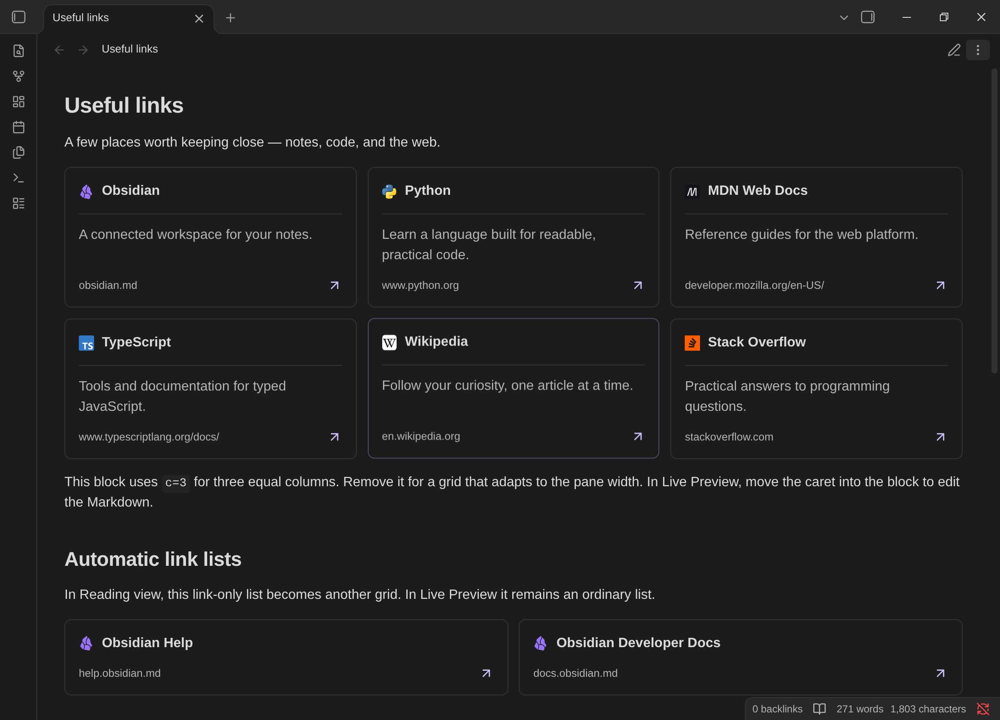
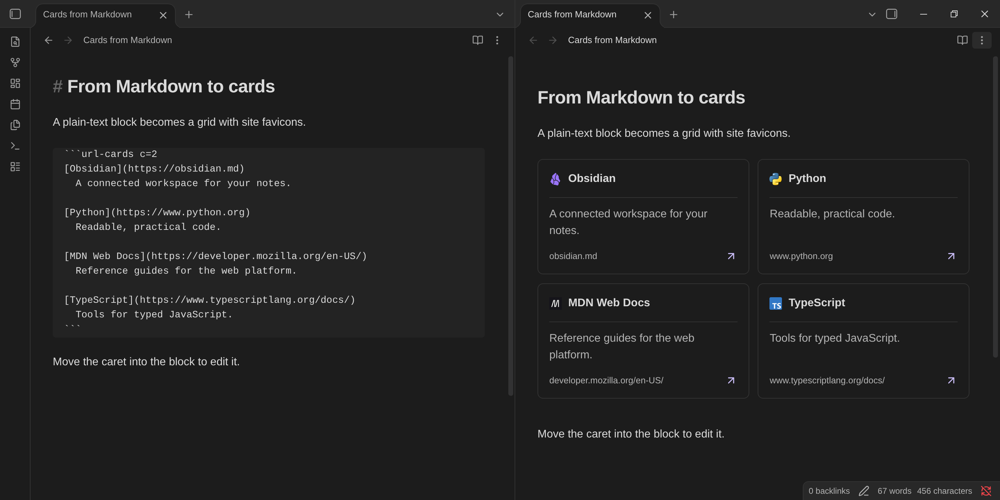

# Pretty URL

An Obsidian plugin that turns web links into responsive card grids, inspired by [Material for MkDocs cards](https://squidfunk.github.io/mkdocs-material/reference/grids/). Cards have a border, hover elevation, keyboard focus outline, optional description, and a visible destination. Columns adapt to the note pane width; URL addresses stay on one line and use an ellipsis when they exceed the card width, without changing the full link destination. Optional site favicons replace the standard link icon when available.



*Real Obsidian screenshots with **Settings → Pretty URL → Favicons** enabled. Favicons are off by default; enabling them fetches icons directly from the linked sites and caches them locally.*

Requires Obsidian 1.5.0 or newer.

## Card blocks

Use a fenced `url-cards` block for predictable rendering in both Reading view and Live Preview:

````markdown
```url-cards
[Material grids](https://squidfunk.github.io/mkdocs-material/reference/grids/)
  Responsive cards for documentation.

[Obsidian](https://obsidian.md)
  Notes, linked together.

https://developer.mozilla.org/en-US/
```
````

- One `http://` or `https://` URL per line. Bare URLs, `<https://example.com>`, and `[Title](https://example.com)` are accepted.
- Optional list markers (`-`, `*`, `+`, or `1.` / `1)`) are accepted.
- Indent description lines by at least two spaces or one tab. Multiple lines are preserved. Blank lines are optional separators.
- Without a title, the hostname becomes the title.
- Labels and descriptions are plain text, not rendered Markdown or HTML. Escape brackets in titles as `\[` and `\]`.
- Encode spaces in URLs as `%20`; angle-bracket destinations such as `[Title](<https://example.com/a_(b)>)` are supported. Optional Markdown link title attributes are not part of the block syntax.
- Invalid non-indented lines produce line-numbered messages; valid cards in the same block still render. An empty block shows instructions.

In Live Preview, move the caret into the block to edit its source and outside it to see the cards again. Source mode always retains ordinary Markdown. The original Markdown is never rewritten by rendering.



*Source mode (left) and Live Preview (right). In Live Preview, only explicit `url-cards` blocks render as cards. Ordinary link lists become cards only in Reading view.*

See [example.md](example.md) for a note you can copy into a vault.

### Fixed column counts

Add `c=N` after `url-cards` to force exactly N equal-width columns for that block:

````markdown
```url-cards c=3
[Obsidian](https://obsidian.md)
[Material](https://squidfunk.github.io/mkdocs-material/)
[MDN](https://developer.mozilla.org/)
[TypeScript](https://www.typescriptlang.org/)
```
````

The first three cards share a row; the fourth starts the next row. Explicit columns override minimum card width and remain fixed even in narrow panes. Fewer cards leave unused column slots instead of stretching across the whole row. Without `c=`, the existing responsive layout is unchanged. Each block has its own column count, including blocks inside callouts and lists.

Use a positive integer, such as `c=1`, `c=2`, or `c=3`. Invalid or repeated `c=` values show a grid error and retain automatic layout. The option works in Reading view and Live Preview; editing the fence updates the grid.

## Automatic cards

Enabled by default in **Reading view only**:

- A paragraph containing only web links becomes a card grid. Several links separated by whitespace or line breaks may share the same grid.
- An ordered or unordered list becomes a grid when **every item** contains exactly one plain web link.

```markdown
https://obsidian.md

- [Material](https://squidfunk.github.io/mkdocs-material/)
- [MDN](https://developer.mozilla.org/)
```

Inline links in prose, mixed-content lists, nested lists, task lists, image links, and formatted link labels remain unchanged. Disable automatic paragraphs or lists independently in **Settings → Pretty URL**. Use explicit `url-cards` blocks for grids in Live Preview.

## Command

Run **Pretty URL: Insert URL card grid** from the command palette:

- With no selection: insert a two-card example at the caret, separating it from surrounding text with newlines.
- With selected URLs or Markdown links: convert them to a `url-cards` block, preserving titles and indented descriptions.
- With invalid selected text: show a notice and leave the selection unchanged.

Select whole lines, outside any existing code fence. You can assign a hotkey through Obsidian's Hotkeys settings.

## Appearance and privacy

The minimum card width is configurable from 180–420 px (default 260 px). CSS uses Obsidian theme variables, supports reduced motion, and has print styles. Card links use Obsidian's standard external-link behavior with `noopener noreferrer`.

On Obsidian 1.13 and newer, the plugin's settings also appear in settings search. Older supported versions retain the same controls in **Settings → Pretty URL**.

With favicons disabled (the default), rendering cards makes no requests to linked sites. Titles and descriptions are supplied in the note, not fetched from pages. Plugin settings are stored in the plugin folder's `data.json`.

This is an Obsidian-native card syntax, not a parser for MkDocs `<div class="grid cards" markdown>` markup, Material icon shortcodes, or generic non-link grids.

### Favicons and caching

Enable **Settings → Pretty URL → Favicons** to fetch each visible card's site icon directly from `/favicon.ico`. This works for explicit blocks in Reading view and Live Preview, and automatic cards in Reading view. The standard link icon stays visible while loading and when the icon is missing, unsupported, or cannot be decoded.

- Only visible icons initiate work; offscreen cards wait until scrolled into view. No page HTML, page previews, or third-party favicon service is fetched.
- Each origin (scheme, hostname, and port) shares one in-flight lookup and one cached result across cards and notes. At most three native requests run at once, including across plugin reloads.
- Both successful icons and failures persist under `<plugin-folder>/favicon-cache/`. Small per-origin metadata files and raster images are cached on disk; resolved results and resource URLs are memoized in memory. Displayed images use local files, not remote image URLs.
- Cache entries do not expire and there are no automatic retries. Use **Settings → Pretty URL → Clear favicon cache** when an icon changes or a temporary/offline failure should be retried. If favicons are enabled, visible cards fetch again; hidden cards still wait. Clearing cache does not change your notes.
- Site requests reveal your IP address and request time to the site. Card paths, queries, fragments, credentials, and referrers are not sent. Native HTTP redirects may be followed by Obsidian's request API.
- Supported small raster responses: ICO, PNG, JPEG, GIF, and WebP, up to 256 KiB. HTML and SVG responses are rejected. The size limit is checked after the native API supplies the response body; it is not a streaming download limit.
- Disabling favicons stops new/queued requests and restores link icons. Already-started native requests cannot be aborted and may finish, but stale results do not alter the disabled view. If cache writes fail, safe session outcomes prevent repeated fetches; persistence across restart requires a writable plugin folder.


## Development

```sh
npm ci
npm run build
npm test
```

`npm run dev` watches and rebuilds `main.js`; copy the bundle and CSS into your vault and reload the plugin after changes. The runtime uses Obsidian and its bundled CodeMirror API; no separate runtime dependency installation is required.

### Releases

Update `package.json`, `package-lock.json`, `manifest.json`, and `versions.json` together, commit the changes, and push a tag matching the stable `X.Y.Z` version exactly (without a `v` prefix). The release workflow runs the tests and production build, uploads `main.js`, `manifest.json`, and `styles.css` to a draft release, generates [GitHub build provenance attestations](https://docs.github.com/en/actions/security-for-github-actions/using-artifact-attestations/using-artifact-attestations-to-establish-provenance-for-builds) for those exact files, and publishes only after attestation succeeds.

The workflow does not overwrite existing releases. If a run fails after creating its draft, remove that failed draft before rerunning. Existing releases are not retroactively attested by adding this workflow.

The [community scorecard](https://community.obsidian.md/plugins/pretty-url) scans the latest published release, not the repository's HEAD. Source fixes and the attestation workflow will only be reflected after a new release is published and scanned.

After downloading a release asset, verify its provenance with GitHub CLI:

```sh
gh attestation verify main.js --repo g-kamil/pretty-url
gh attestation verify manifest.json --repo g-kamil/pretty-url
gh attestation verify styles.css --repo g-kamil/pretty-url
```

## License

MIT. The implementation uses Obsidian's bundled icons and theme variables; it does not copy Material for MkDocs code or assets.
